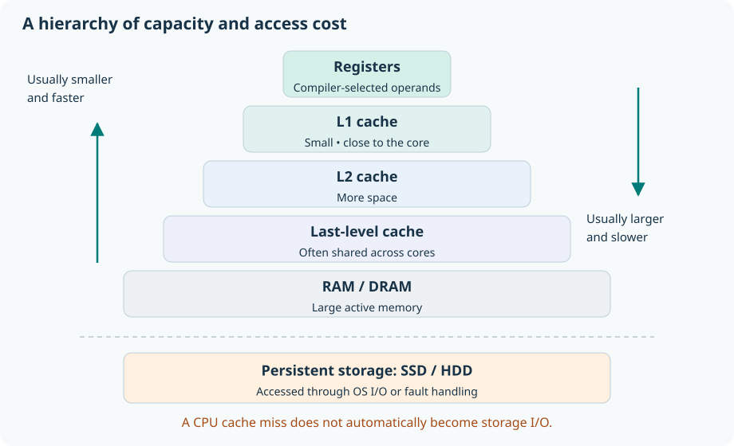
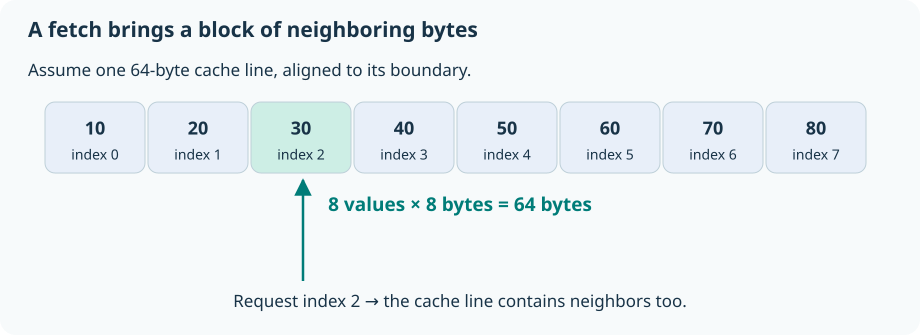
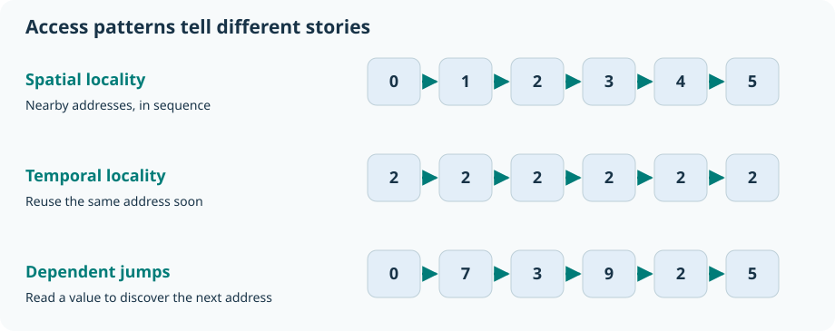
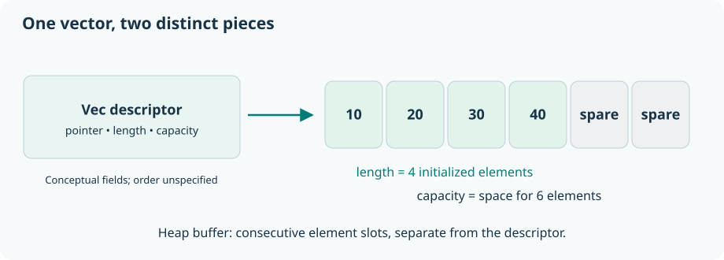
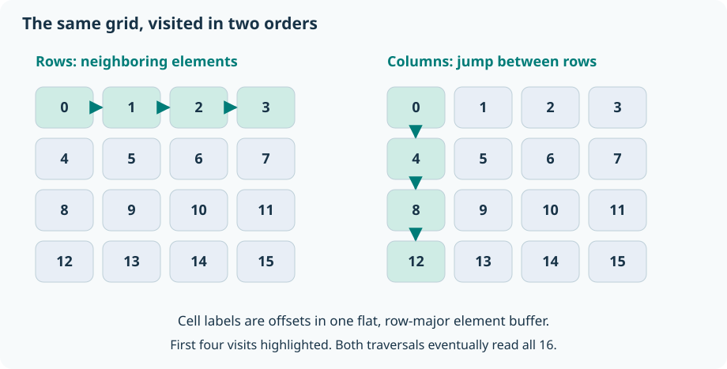
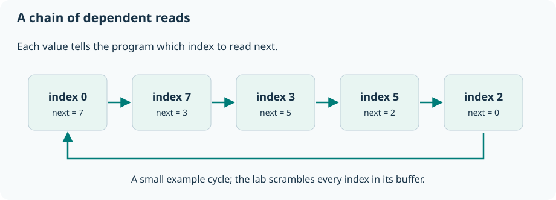
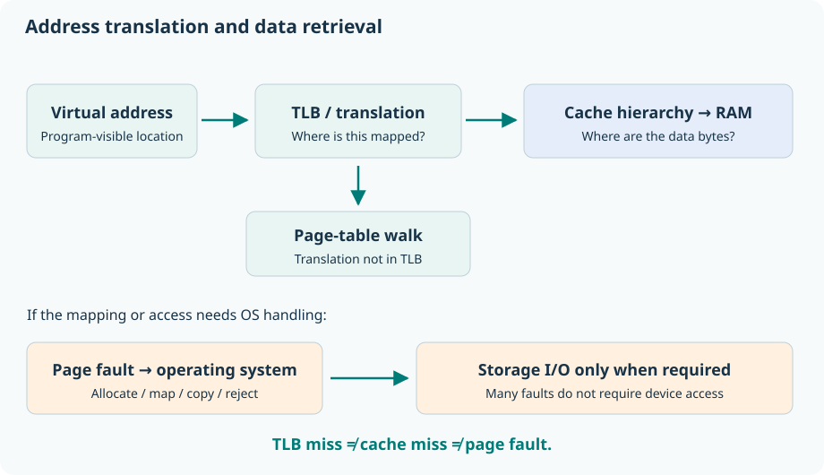
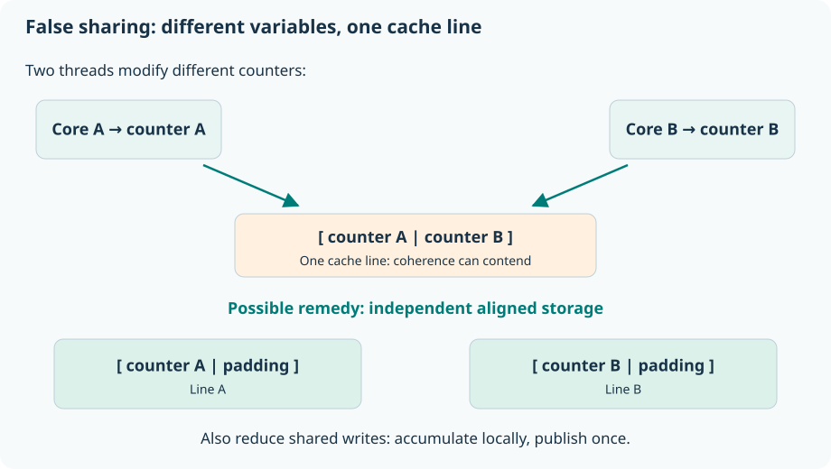

# Memory Hierarchy and Latency

## A beginner’s chapter with diagrams and Rust experiments

**Who this is for:** readers who are new to computer architecture and may also be new to Rust. No knowledge of caches, pointers, or benchmarking is assumed. The examples use safe Rust and the standard library only.

**Learning goals:** explain where data lives; distinguish latency from bandwidth; predict how access order affects performance; read simple Rust memory layouts; and run small experiments without mistaking their results for universal hardware constants.

**Suggested reading path:** read sections 1–8 first, run the first two labs, then continue to virtual memory and multicore behavior. Allow about 60–90 minutes including experiments. Advanced details are introduced gradually.

## 1. Why a fast CPU can still wait

Imagine preparing a meal. Ingredients already in your hand are immediately usable. Ingredients on the counter take a little longer to reach. A pantry trip costs more time. A trip to a shop costs much more.

A processor, or **CPU**, performs operations such as adding numbers and comparing values. It also needs instructions that tell it what to do and data to work on. If a required value has not arrived, an operation that depends on it must wait. A CPU can sometimes do other independent work during that wait, but a faster arithmetic unit does not make the missing value arrive sooner.

Consider a program that adds ten million numbers. Its arithmetic is simple. Its performance may depend more on getting those numbers to the CPU than on adding them.

Computer designers therefore use several kinds of storage. Small, fast storage holds a little data close to the execution units. Larger storage holds more data at greater access cost. This arrangement is the **memory hierarchy**.

The cooking analogy has limits: real caches hold copies, requests can overlap, and data may come from another CPU core. Nevertheless, “keep frequently needed ingredients nearby” is a useful starting point.

## 2. The vocabulary: bits, bytes, addresses, and time

A **bit** holds a 0 or a 1. A **byte** contains eight bits. Memory can be pictured as a long sequence of numbered byte locations. A location’s number is its **address**. A value can occupy several consecutive bytes.

Rust’s `u8` type is an unsigned 8-bit integer, occupying one byte. `u64` is an unsigned 64-bit integer, occupying eight bytes. “Unsigned” means the type represents nonnegative whole numbers. `usize` is an unsigned integer type sized for the target’s addresses: typically eight bytes on a 64-bit target and four on a 32-bit target. [Rust primitive layouts](https://doc.rust-lang.org/reference/type-layout.html#primitive-data-layout)

An address is like a street number; the number stored there is the house’s contents. They are different things. A **pointer** holds information used to locate another value. A Rust reference such as `&value` safely borrows access to a value without taking ownership of it.

We will use these units:

| Unit | Meaning | Example conversion |
|---|---|---|
| ns | nanosecond; one billionth of a second | 1,000 ns = 1 μs |
| μs | microsecond; one millionth of a second | 1,000 μs = 1 ms |
| ms | millisecond; one thousandth of a second | 1,000 ms = 1 s |
| KiB | 1,024 bytes | 32 KiB = 32,768 bytes |
| MiB | 1,024 KiB | 1 MiB = 1,048,576 bytes |
| GB/s | billions of bytes per second | A rate of data transfer |

A **clock cycle** is one tick of a processor clock. At an assumed fixed 3 GHz, one cycle lasts about 0.333 ns, so a 90 ns wait spans about 270 cycles. These are arithmetic examples, not claims about the machine running your code. Real clock frequencies change, and modern CPUs can execute several operations during some cycles.

## 3. Meet the hierarchy



**Figure 1.** Lower levels usually offer more capacity at greater access cost. The storage boundary is deliberate: ordinary CPU loads do not automatically continue from RAM to an SSD.

**Registers** are tiny storage locations used directly by CPU instructions. A compiler tries to keep useful intermediate values there. You do not select a hardware register by declaring a normal Rust variable; the compiler chooses placements and may eliminate the variable entirely.

**CPU caches** hold copies of memory data. L1 is closest to a core’s execution machinery; L2 and later cache levels provide more space at higher access cost. Many systems have separate L1 instruction and data caches, private L1/L2 caches, and a shared last-level cache. Exact arrangements vary by processor. **RAM**, usually DRAM, holds a much larger working collection of program data. These are the broad tradeoffs described in [Arm’s hierarchy overview](https://learn.arm.com/learning-paths/servers-and-cloud-computing/memory-subsystem/cache-hierarchy/).

**Persistent storage**, such as an SSD or hard drive, retains files when power is removed. Programs usually access files through the operating system. The OS also uses RAM to cache file contents; therefore, a file read need not reach the physical device. [Linux page cache](https://docs.kernel.org/6.11/mm/page_cache.html)

The following is an **invented teaching model**. It makes the scale of waiting concrete. None of its values are measurements, processor specifications, or promises. Device I/O latency also depends on request size and queueing, so it is not directly comparable to a small CPU load.

| Location or operation | Assumed example latency | If 1 ns became 1 second |
|---|---|---|
| A simple register-to-register operation | 0.3 ns | 0.3 seconds |
| L1 data-cache hit | 1 ns | 1 second |
| L2 hit, end to end | 4 ns | 4 seconds |
| Last-level cache hit, end to end | 15 ns | 15 seconds |
| DRAM-served load, end to end | 90 ns | 1 minute 30 seconds |
| Small SSD read requiring device I/O | 100 μs | About 28 hours |
| Small hard-drive read requiring device I/O | 5 ms | About 58 days |

Treat this table as a scale drawing with fictional dimensions. Use processor documentation and measurements for your actual system. For example, Intel provides tools to investigate how latency changes under memory traffic. [Intel Memory Latency Checker](https://www.intel.com/content/www/us/en/download/736633/intel-memory-latency-checker-intel-mlc.html)

### Stack and heap belong to a different classification

The **stack** organizes active function calls and their local storage. The **heap** supplies allocations whose lifetimes and sizes need more flexibility. Neither is a separate cache level. Both ultimately use the memory system and can benefit from caches.

A small local array might be on a stack, while a vector’s element buffer is allocated on the heap. A compiler may keep some values in registers or remove storage altogether. “Stack is fast; heap is slow” confuses allocation and lifetime management with access to an existing value. [The Rust Book: ownership, stack, and heap](https://doc.rust-lang.org/book/ch04-01-what-is-ownership.html)

## 4. What happens when Rust reads a value?

Start with:

```rust
let values = vec![10u64, 20, 30, 40];
let answer = values[2];
println!("{answer}");
```

`vec!` creates a vector. The suffix in `10u64` selects the element type. Vector indices start at zero, so `values[2]` reads 30, the third element. Rust checks indexing for bounds unless optimization proves the check unnecessary.

In a simplified hardware story, the CPU asks for the bytes containing that value. If a useful copy is in L1, that access is a **hit**. Otherwise it is a **miss**, and another part of the memory system must satisfy the request. A deeper cache or RAM can supply it. Think of “checking levels” as a conceptual explanation; real processors overlap parts of lookup, address translation, and execution.

If data must be fetched, caches normally transfer a **cache line**, a block containing multiple adjacent bytes. A 64-byte line is common on the processors used in many examples, but it is not a Rust guarantee or a universal hardware size. [Intel: caches and loop blocking](https://www.intel.com/content/www/us/en/developer/articles/technical/loop-optimizations-where-blocks-are-required.html)



**Figure 2.** In this aligned illustration, eight `u64` values occupy one 64-byte line. A real vector’s first element need not begin at a cache-line boundary, so eight adjacent elements can straddle two lines.

If your next operation needs a neighbor already in that line, the fetch may serve more than one useful value. If your next operation jumps far away, much of that fetched block may go unused.

The literal example above is too small and predictable to benchmark: a compiler may compute 30 directly without allocating the vector. The hardware story describes a load when the optimized program actually needs one.

## 5. Locality: make one fetch do more useful work

**Spatial locality** means using nearby addresses close together in time. Reading a vector from beginning to end is an example. **Temporal locality** means reusing the same data soon enough that a useful copy may remain nearby.



**Figure 3.** Access order influences how much useful work follows each memory fetch.

Here is a sequential sum:

```rust
fn sum(values: &[u64]) -> u64 {
    let mut total = 0;
    for &value in values {
        total += value;
    }
    total
}
```

Read `&[u64]` as “a borrowed slice of unsigned 64-bit integers.” A **slice** is a view over consecutive elements. `mut` allows a variable to change. The pattern `&value` copies each small integer out of its borrowed position. The final expression, `total`, returns the answer; Rust does not require a `return` keyword here.

The loop asks for adjacent elements. Hardware **prefetchers** may recognize sequential or regular patterns and request later blocks early. This can hide waiting, although it does not eliminate the work of transferring data. Irregular dependent jumps are harder to anticipate. Cache capacity, line transfers, and prefetching all matter. [Arm: locality and prefetching](https://learn.arm.com/learning-paths/servers-and-cloud-computing/memory-subsystem/cache-hierarchy/)

A **working set** is the data actively needed during a phase of computation. If a repeatedly reused working set stays within a suitable cache, reuse can be cheap. If it grows substantially, some reused data may be displaced before its next use.

“Fits in cache” is only a first approximation. A cache is commonly divided into **sets**, with only a limited number of lines allowed in each set. Several addresses competing for one set can displace one another even when total cache space would be sufficient. This is a **conflict miss**. First use gives a **compulsory miss**; insufficient total space gives a **capacity miss**. Other programs and cores can also affect what stays cached.

**Checkpoint:** if two loops visit the same million integers, can they take different times? Yes. Equal amounts of logical work do not guarantee equal data movement or equal overlap of waiting.

## 6. Latency and bandwidth answer different questions

**Latency** asks, “How long until a particular request produces usable data?” **Bandwidth** asks, “How much data can be delivered per second over a sustained interval?”

A road can take ten minutes to traverse yet carry thousands of vehicles per hour. A memory system can likewise have significant individual access latency while delivering a high total data rate when many requests are in flight.

Suppose a fictional system has 90 ns load latency and can sustain 40 GB/s for a particular streaming workload. Reading one value does not become instantaneous because bandwidth is high. Conversely, a stream does not necessarily pay an isolated 90 ns wait for every element: prefetching, cache-line reuse, and multiple outstanding requests can overlap work. [Intel: memory performance](https://www.intel.com/content/www/us/en/developer/articles/technical/memory-performance-in-a-nutshell.html)

For a hypothetical 400 MB transfer at an achieved 40 GB/s, the transfer-only estimate is:

```text
time = bytes / bytes per second
     = 400,000,000 / 40,000,000,000
     = 0.01 seconds = 10 milliseconds
```

This estimate excludes startup costs and competing bottlenecks. It also assumes the stated bandwidth is achieved. Counting only bytes useful to your algorithm can underestimate actual traffic if each request brings in extra unused bytes or causes writes.

### A small average-access calculation

Use an explicitly hypothetical two-level model: an L1 lookup takes 1 ns; a miss then costs an additional 89 ns. If 95% of accesses hit:

```text
average = hit time + miss probability × additional miss penalty
        = 1 ns + 0.05 × 89 ns
        = 5.45 ns
```

Equivalently, `0.95 × 1 + 0.05 × 90 = 5.45 ns`. At a 50% hit rate, the same model gives 45.5 ns. This is why reducing misses can matter more than shaving an arithmetic instruction.

For three lookup stages, one useful teaching formula is `t1 + m1 × (t2 + m2 × t_memory)`, where times are **additional** costs and `m2` is the miss rate among accesses that actually reach L2. Do not combine incremental lookup costs with end-to-end values from the earlier table; that would double-count time. These models omit overlap, queueing, and coherence effects, so they are not full runtime predictors.

## 7. Rust layout: what a vector actually contains

A `Vec<T>` owns a contiguous allocation of its elements. It keeps a pointer, a length, and a capacity as bookkeeping. The exact field order is unspecified. A local vector’s bookkeeping and its heap-allocated element buffer are distinct. [Rust’s Vec guarantees](https://doc.rust-lang.org/std/vec/struct.Vec.html#guarantees)



**Figure 4.** `len` counts initialized elements. `capacity` counts space available before growth is needed. The diagram is conceptual and does not specify the descriptor’s field order.

`Vec<u64>` keeps its numbers next to one another. `Vec<Box<u64>>` keeps box pointers next to one another; the separately allocated numbers they point to need not be neighbors. `Vec<String>` similarly keeps string descriptors together while character buffers live in separate allocations. “The vector is contiguous” applies to the vector’s elements, not recursively to everything they reference.

Linked structures can need a sequence of dependent address discoveries: first read this node, then discover where the next node is. Arrays often support simpler traversal. This is one reason the standard library recommends array-based collections for many workloads. A linked structure can still be appropriate for particular requirements; choose based on the operations you need. [Rust collections guidance](https://doc.rust-lang.org/std/collections/index.html)

Ownership and borrowing help prevent invalid access and unwanted sharing. They do not automatically choose a locality-friendly layout. Similarly, using `unsafe` is not a prerequisite for good locality; all labs here are safe Rust.

### Lab 1: inspect neighboring addresses

The companion project includes `basics.rs`, which prints a sum, type size, and element addresses:

```rust
let values: Vec<u64> = vec![10, 20, 30, 40];
for (index, value) in values.iter().enumerate() {
    println!("index {index}: value {value}, address {value:p}");
}
```

`enumerate()` attaches each element’s index. `:p` prints a pointer address. The four addresses should advance by eight bytes; their absolute values can change between runs. This demonstrates layout, not access latency. The full program also prints `sum = 100`.

## 8. Lab 2: same matrix, different traversal

A **matrix** is a grid. We can store a square matrix in one vector, row after row. For `n` columns, element `(row, col)` is at `row * n + col`. This is our chosen **row-major** representation. Rust does not automatically impose row-major layout on every type that someone calls a matrix.



**Figure 5.** The two traversals read the same values but reach them in different orders. Arrows show the order, not elapsed time.

Compare these two functions:

```rust
fn row_sum(data: &[u64], n: usize) -> u64 {
    let mut sum = 0u64;
    for row in 0..n {
        for col in 0..n {
            sum = sum.wrapping_add(data[row * n + col]);
        }
    }
    sum
}

fn column_sum(data: &[u64], n: usize) -> u64 {
    let mut sum = 0u64;
    for col in 0..n {
        for row in 0..n {
            sum = sum.wrapping_add(data[row * n + col]);
        }
    }
    sum
}
```

`0..n` means zero through `n - 1`. The functions assume a buffer containing at least `n * n` elements. `wrapping_add` makes the overflow policy explicit: arithmetic wraps around if it exceeds the integer’s range. Our chosen data sizes do not overflow the sum.

Row traversal moves eight bytes between adjacent inner-loop reads. With `n = 2048`, column traversal jumps `2048 × 8 = 16,384` bytes each time. It may revisit the rest of a previously fetched line too late for convenient reuse. A large power-of-two stride may also interact badly with cache-set mapping and address translation.

The companion program allocates a 32 MiB matrix, checks that both sums agree, warms both paths, and records seven trials with alternating order. It reports median milliseconds and the column/row time ratio. Allocation and printing are outside the timed region.

**Predict before running:** which traversal should benefit more from neighboring bytes? On many machines, row traversal wins for this size. The actual ratio depends on the CPU, caches, compiler, and system load; it is not guaranteed.

**What this measures:** elapsed time for whole traversal functions. It is not the latency of a single RAM access. Compiler vectorization, bounds checks, prefetching, translation, and overlapping requests all contribute. A compiler can combine several additions into wider operations, which is part of the measured program’s behavior.

**Try next:** change `n` to 256, then 1024, then 2047. A small matrix may fit in cache. Comparing 2047 with 2048 can reveal sensitivity to a regular stride, but a timing difference alone does not prove a specific cache-set conflict. Use hardware counters or profiling to investigate causes.

### When changing loop order is not enough: blocking

For computations that reuse data, process a small **tile** or block before moving on. Imagine multiplying large matrices: repeatedly using a small group of rows and columns can reduce repeated trips for the same values. This is **blocking** or **tiling**. Intel’s [loop-blocking explanation](https://www.intel.com/content/www/us/en/developer/articles/technical/loop-optimizations-where-blocks-are-required.html) discusses this strategy.

Blocking is not an automatic improvement for every loop. A single sequential sum already visits each value once and has no repeated element use to rescue. The purpose is to improve the locality the actual algorithm needs, not to add extra loop machinery indiscriminately.

## 9. Lab 3: make each read wait for the previous read

A sequential scan lets the CPU predict later addresses. To expose waiting more directly, build an array where each element tells us the index to visit next:

```rust
fn walk(next: &[usize], mut index: usize, steps: usize) -> usize {
    for _ in 0..steps {
        index = next[index];
    }
    index
}
```

If `next[0]` is 7, the next read is `next[7]`. Its result selects the following read. This creates a dependency: the next index is not known until the current read completes.



**Figure 6.** Every arrow depends on the preceding read. The companion program builds one scrambled cycle that visits every element before returning to its start.

The full `chase.rs` program creates a permutation, links its elements into one cycle, warms the buffer with one complete walk, and times repeated dependent steps. Setup is not timed. It tries buffers from 4 KiB through 64 MiB and reports the median of five trials for each size. On a 64-bit target, a 1 MiB index buffer contains `1,048,576 / 8 = 131,072` indices.

Why one cycle? Simply generating random next indices could accidentally create a short loop that touches only a few elements. That would claim to test a large buffer while repeatedly accessing a small part. A unit test checks that the construction really visits every element once before returning.

As the footprint grows, you may see increases in nanoseconds per dependent step. A larger footprint can require more service from deeper caches or RAM. Address-translation overhead can also increase. Professional latency tools use related dependent-read techniques. [Intel: how latency checking works](https://www.intel.com/content/www/us/en/developer/articles/tool/intelr-memory-latency-checker.html)

**Read the label carefully:** the program prints “ns / dependent step,” not “exact DRAM latency.” Each step also includes loop work, indexing, possible bounds checks, and address translation. The index table stores multiple entries per cache line, so it does not guarantee one new cache-line fetch on every step. Other cores, frequency changes, and page placement can affect results.

Do not label every bend “this is exactly my L2 size.” Compare with your machine’s cache information first, repeat measurements, and consider translation effects. The warm-up deliberately reduces first-touch costs; it cannot make a large buffer fit inside a small cache.

## 10. Lab 4: carry the data your loop actually uses

Suppose each particle has four eight-byte fields:

```rust
#[repr(C)]
struct Particle {
    x: f64,
    y: f64,
    z: f64,
    mass: f64,
}
```

`f64` is a 64-bit floating-point number. `#[repr(C)]` requests a defined field-order layout using C-style alignment rules. A normal Rust struct does not promise declaration-order fields. Padding can add space to a struct, so inspect `size_of::<Particle>()` instead of assuming all field sizes simply add. [Rust layout reference](https://doc.rust-lang.org/reference/type-layout.html#the-c-representation)

An **array of structures**, `Vec<Particle>`, keeps complete records together. A **structure of arrays** keeps separate vectors for `x`, `y`, `z`, and `mass`. For an `x`-only calculation, a separate `Vec<f64>` places the wanted values next to one another. If a loop uses every field of each particle, complete records may be convenient and efficient.

On a target where this record is 32 bytes, 1,000,000 records occupy 32,000,000 element-buffer bytes. A million `x` values alone occupy 8,000,000 bytes. The x-only footprint is one quarter as large. That is a footprint calculation, not a promised fourfold speedup. Alignment, fetch reuse, vectorization, and the rest of the program matter.

The `layout` lab prints the actual sizes and confirms that a record-based x sum agrees with an x-only sum. It does not benchmark them. Keeping separate arrays also creates bookkeeping work: indices must continue to refer to the same particle across arrays.

**Checkpoint:** would splitting a record into columns always help? No. First ask which fields the hot loop reads together, and how often.

## 11. Virtual memory: another kind of lookup

Programs normally use **virtual addresses**. The processor translates them into physical addresses under mappings managed by the OS. Memory is mapped in units called **pages**. Page size depends on the system; 4 KiB is a common example, and larger pages also exist. [Linux page tables](https://docs.kernel.org/mm/page_tables.html)



**Figure 7.** The translation path answers “where is this address mapped?” The data-cache path answers “where is a useful copy of these bytes?” Hardware can overlap parts of these paths; the diagram shows responsibilities.

A **translation lookaside buffer**, or **TLB**, caches address translations. On a TLB miss, the processor may need a **page-table walk**, consulting translation data in memory. That translation data can itself be cached. A TLB miss is not automatically a page fault.

A **page fault** transfers control to the OS because the mapping or permissions need attention. The OS may allocate a page, handle a copy-on-write request, obtain file data, or reject an invalid access. Some faults require storage I/O; many do not. [Arm: address translation terminology](https://learn.arm.com/learning-paths/servers-and-cloud-computing/performix-memory-access/how-to-0/), [Linux page-fault handling](https://docs.kernel.org/mm/page_tables.html)

This explains two observations. First, touching many widely separated pages can introduce translation costs beyond ordinary cache effects. Second, initial access to newly allocated memory can differ from later access. Allocating a large logical buffer and making every page physically ready are not always the same event.

An L1 miss does not mean “read from SSD.” A TLB miss does not mean “read from SSD.” The OS and the nature of the mapping determine whether storage I/O is required. File I/O, virtual-memory management, and CPU caches interact, but they are different mechanisms.

## 12. Writes and multiple cores

A CPU core often has private caches. When several cores access the same memory, **cache coherence** coordinates their copies. For writes, a core may need permission to modify a whole line. **False sharing** occurs when threads modify different variables that happen to occupy the same cache line, creating unnecessary coherence traffic. [Arm: false sharing](https://learn.arm.com/learning-paths/servers-and-cloud-computing/false-sharing-arm-spe/how-to-1/)



**Figure 8.** Logical independence does not guarantee physical separation at cache-line granularity.

For an assumed 64-byte cache line, this Rust wrapper demonstrates spacing:

```rust
use std::sync::atomic::AtomicU64;

#[repr(align(64))]
struct PaddedCounter(AtomicU64);
```

`AtomicU64` supports synchronized access to a shared integer. `repr(align(64))` requests at least 64-byte alignment; the type’s size is rounded to satisfy alignment for array elements. This example is for targets that support 64-bit atomics. It does not discover the hardware’s cache-line size. Larger lines or other platform behavior can require a different design. Padding also consumes extra memory. [Rust alignment rules](https://doc.rust-lang.org/reference/type-layout.html#the-alignment-modifiers), [Intel false-sharing example](https://www.intel.com/content/www/us/en/docs/vtune-profiler/cookbook/2024-0/false-sharing.html)

The companion `sharing` example also applies a broader idea: each thread accumulates locally and publishes one result. Reducing shared writes can be more useful than padding frequent writes. Scoped threads finish before the parent combines their results. The example uses relaxed atomic operations because the counters communicate only their own numeric results and completion is synchronized by joining the threads. It is a correctness/layout example, not a false-sharing speed benchmark. [Rust atomic ordering](https://doc.rust-lang.org/std/sync/atomic/enum.Ordering.html), [scoped threads](https://doc.rust-lang.org/std/thread/fn.scope.html)

Writes can have costs beyond the store instruction itself. In common write-back designs, modified lines are marked **dirty** and written to a lower level later. Updating a line may also require obtaining ownership or fetching it first. A timing interval around a loop is therefore not necessarily the time until all bytes have reached RAM. Consult the target architecture’s [optimization documentation](https://www.intel.com/content/www/us/en/developer/articles/technical/intel64-and-ia32-architectures-optimization.html) for detailed write behavior.

On larger systems, **NUMA** means access costs can depend on which processor’s memory is involved. Adding threads does not guarantee proportional speedup: memory traffic, coherence, and bandwidth can become shared bottlenecks. [Intel’s memory latency overview](https://www.intel.com/content/www/us/en/download/736633/intel-memory-latency-checker-intel-mlc.html)

## 13. Run the companion project

The `memory-lab` folder contains a Cargo project with five programs and no external crate dependencies. You need an installed Rust toolchain. The project declares Rust 1.66 or newer; the supplied examples were checked with Rust 1.99.0. See the [official Rust installation instructions](https://www.rust-lang.org/tools/install) if needed.

Open a terminal in the `memory-lab` folder, then run:

```sh
cargo run --release --bin basics
cargo run --release --bin matrix
cargo run --release --bin chase
cargo run --release --bin layout
cargo run --release --bin sharing
cargo test --release
```

Cargo builds and runs a selected binary. `--release` enables the optimized build profile, which is important when studying performance. The first run may spend time compiling; compilation is outside the timers inside the programs. [Cargo profiles](https://doc.rust-lang.org/cargo/reference/profiles.html)

For a shorter check, use `cargo run --release --bin chase -- --quick` or the equivalent command for `matrix`. The `--` passes subsequent arguments to the program. Quick mode uses smaller workloads and is intended for a smoke check, not hardware characterization.

Default matrix storage is 32 MiB. The chase’s largest final index buffer is 64 MiB on every target; construction temporarily also holds an ordering vector, making the two main buffers about 128 MiB together. Reduce sizes if that is unsuitable for your machine. Memory pressure changes the phenomenon you are trying to observe.

### Why the timer is not the whole experiment

The timed programs use `Instant` for elapsed time and `black_box` around inputs/results to discourage inappropriate optimizer shortcuts. `black_box` is explicitly a best-effort optimization hint. It does not flush caches, force RAM access, or remove timer overhead. [Rust Instant](https://doc.rust-lang.org/std/time/struct.Instant.html), [Rust black_box](https://doc.rust-lang.org/std/hint/fn.black_box.html)

A sound reading of these experiments follows this sequence:

1. **Predict.** State which access pattern you expect to benefit and why.
2. **Check correctness.** Ensure the compared functions compute equivalent results. Fast wrong answers are not a successful optimization.
3. **Separate setup.** Allocate and initialize outside the region whose cost you want to study.
4. **Time enough work.** A single tiny access is too small for an ordinary wall-clock timer to characterize reliably.
5. **Repeat.** Use multiple trials and inspect variation. A median reduces sensitivity to isolated interruptions but cannot remove systematic bias.
6. **Record context.** Note CPU model, Rust version, target architecture, build profile, workload size, and background activity.
7. **Explain limits.** Report the measured operation and units. Investigate a proposed cause before treating it as proven.

The labs intentionally avoid claims of universal timing ratios. A sequential scan primarily studies whole-loop throughput; dependent walking exposes serial waiting more directly. Neither is a complete professional microbenchmark suite. For rigorous hardware characterization, use suitable profiling tools, account for CPU placement and frequency, and inspect generated machine code where needed.

## 14. Worked reasoning exercises

### Exercise 1: useful bytes per cache line

Assume 64-byte lines and eight-byte integers. You read every integer in a large aligned array exactly once in order. How many requested integers fit in one line? What if you instead request only the first integer in each line?

**Answer:** eight integers fit. Sequential traversal can use all 64 fetched bytes. Reading just one integer per line uses eight of the fetched bytes, a 12.5% useful-byte fraction in this simplified model. Real traffic can include prefetches and other effects. If you deliberately read fewer values, compare time per requested value as well as total time; the logical workloads differ.

### Exercise 2: miss-rate arithmetic

In the section 6 model, use a 90% L1 hit rate.

**Answer:** `1 + 0.10 × 89 = 9.9 ns`. The hit rate fell by five percentage points compared with the earlier example, but average time rose from 5.45 to 9.9 ns. Expensive misses can dominate an average.

### Exercise 3: footprint

How many bytes do 500,000 `u64` elements occupy, excluding vector bookkeeping and allocator overhead?

**Answer:** `500,000 × 8 = 4,000,000` bytes, approximately 3.81 MiB. This is the initialized element footprint; spare vector capacity could make the allocation larger.

### Exercise 4: matrix stride

For a row-major matrix with 1,024 columns of `u64`, how far apart are successive column-traversal reads?

**Answer:** 8,192 bytes. The algorithm moves to the next row while keeping the column fixed. Row traversal instead advances eight bytes within its inner loop.

### Exercise 5: two ways to wait

Why might a sequential sum have a much smaller “nanoseconds per element” result than a dependent walk over a similarly sized buffer?

**Answer:** a scan can reuse fetched lines, allow prefetching, overlap independent memory operations, and benefit from vectorization. The dependent walk cannot freely issue its next indexed read until it learns the next index. Per-element scan time is not isolated load latency.

### Exercise 6: diagnose a misconception

A program slows down after its buffer grows. A teammate says, “It moved from the stack into L3.” What is wrong with that description?

**Answer:** stack/heap organization and cache residency are different classifications. The larger working set may have changed cache behavior, but the timing alone does not establish that. It also may have changed translation, allocation, or paging behavior.

### Exercise 7: choose a layout

An analysis loop reads only the `mass` field of millions of particles. What layout experiment would you try, and what would you measure?

**Answer:** compare the existing record layout with a contiguous mass-only column. Verify equal results, exclude construction if studying repeated analysis, and measure the actual analysis loop across multiple trials. Also consider the cost of maintaining the column in the full application.

## 15. A practical way to apply what you learned

Begin with correct, clear Rust. Measure the part of the application that matters. If memory access appears to be a bottleneck, inspect which bytes that code reads and in what order.

Prefer contiguous traversal when it matches the problem. Keep a frequently reused working set manageable. Avoid carrying large unused fields through a hot loop. Reduce unnecessary allocation and copying. For reusable multidimensional data, consider tiles. For multiple threads, reduce shared writes and check whether independent fields share cache lines. Retest the complete workload after any change.

Algorithm choice still matters: skipping unnecessary work can beat making a slow algorithm slightly more cache-friendly. Likewise, a layout that accelerates one loop can complicate or slow another. Optimize for the workload you actually need.

You can now explain why two programs with the same number of additions can have very different runtimes: the addresses they visit determine what data must move, when it can arrive, and how much waiting the CPU can overlap.

## Glossary

| Term | Meaning |
|---|---|
| Cache hit / miss | Whether the requested data is available at the cache being considered |
| Cache line | The block of adjacent bytes managed by a cache |
| Capacity | How much a storage level or container can hold |
| Coherence | Coordination of shared memory copies across CPU caches |
| Contiguous | Stored in consecutive memory locations |
| Dependent read | A read whose address depends on an earlier read’s result |
| DRAM | Dynamic random-access memory, commonly used for main RAM |
| Latency | Time until a particular operation produces a usable result |
| Bandwidth | Data delivered per unit of time |
| Prefetch | Request data before an explicit demand needs it |
| Spatial locality | Use of nearby addresses close together in time |
| Temporal locality | Reuse of the same data within a short interval |
| Working set | Data actively needed during a phase of execution |
| TLB | A cache of address translations |
| Page fault | Transfer to OS handling for a mapping or access-permission issue |
| False sharing | Coherence contention between distinct variables in one cache line |

## Further reading and source notes

The diagrams, worked examples, and hypothetical timing model were created for this chapter. Hardware descriptions simplify a typical cached CPU; they do not specify every processor. Linked sources support the adjacent concepts. Consult documentation for your particular target before relying on cache sizes, line sizes, instruction costs, or atomic support.

- [The Rust Book](https://doc.rust-lang.org/book/): language foundations, ownership, and borrowing.
- [Rust Vec documentation](https://doc.rust-lang.org/std/vec/struct.Vec.html): allocation, contiguity, and capacity guarantees.
- [Rust layout reference](https://doc.rust-lang.org/reference/type-layout.html): size, alignment, representation, and padding.
- [Arm cache hierarchy learning path](https://learn.arm.com/learning-paths/servers-and-cloud-computing/memory-subsystem/cache-hierarchy/): locality, cache sets, and prefetching.
- [Intel optimization resources](https://www.intel.com/content/www/us/en/developer/articles/technical/intel64-and-ia32-architectures-optimization.html): processor-specific details.
- [Linux page tables](https://docs.kernel.org/mm/page_tables.html): virtual addressing and faults.

References checked 19 October 2026. No performance numbers in the teaching table are presented as measured lab results.
